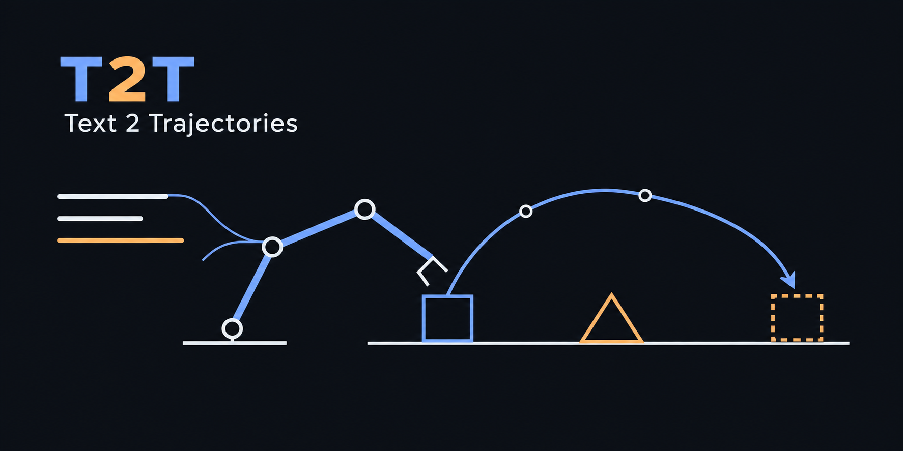

Turn an instruction into a robot movement. Test whether a separate model catches missed requirements, including routes and follow-ups.

`instruction → proposed goal → optional meaning check → geometry checks → robot`

The simulator is a MuJoCo KUKA iiwa cell. Visual Components is the intended industrial target.

The completed LIBERO runs score 392/400 for pi0.5, 391/400 each for OpenVLA-OFT and TurboVLA, 301/400 for OpenVLA and 292/400 for SmolVLA. These use the same tasks and numbered reset states, with each model's published input and action conventions. The KUKA instruction-fidelity study uses different tasks.

## Start here

Python 3.12+; commands work from this folder.

```sh
pip install -r requirements.txt
python run.py demo
python -m unittest test_system
```

The demo downloads one checksum-verified robot XML and executes three supplied goals, including a repeat after the reference object moves. It checks the controller without a language model.

For language input, start [Ollama](https://ollama.com/) and install its [Qwen3 models](https://ollama.com/library/qwen3).

```sh
ollama pull qwen3:1.7b
ollama pull qwen3:4b
python run.py run --method checked "Place the red cube right of the blue cube over the can."
```

Pass several quoted instructions to share history. Objects, directions and edge-to-edge gaps use world coordinates and millimetres. Unsupported or ambiguous requests stop before motion.

The requirement compiler can release an exact gap or an over-can requirement. The released field stays optional on later repeats, while other requirements remain active. This tests compiler behavior; model accuracy on these follow-ups remains under evaluation.

## Plan compatibility

```sh
python run.py compatible-demo
python run.py run --method local-memory --actor qwen3:4b "Place red right of blue, passing over the can." "Repeat."
python run.py run --method history-memory --actor qwen3:4b "Place red right of blue, passing over the can." "Repeat."
python run.py run --method compatible --actor qwen3:4b --reader qwen3:4b "Place red right of blue, passing over the can." "Repeat."
```

`local-memory` uses one reading to update stored requirements. `compatible` adds a reader of the successful instruction history, with the first reading withheld, then selects a motion permitted by both. Both modes share the actor interface and planner. Allowed directions, optional gaps and optional routes stay separate from executed goals.

Both readers receive the last successful plan separately. An instruction can explicitly adopt its gap or direction; a bare repeat keeps optional fields optional. Requests for unavailable earlier planner choices require clarification.

`history-memory` executes a single full-history reading directly. Use the same model as the compatible method's reader to test whether the extra local reading helps beyond the reader alone. These controls share the requirement schema and planner; record model identities and actual call costs when comparing different sizes.

The demo checks supplied requirements in MuJoCo, including a repeat after the reference moves. Optional gaps first try 20/40/60/80/100 mm, then candidates derived from workspace and obstacle boundaries within 5-200 mm. Routes are direct or over-can; explicit gaps keep their requested value. Planning reserves 1 mm around obstacle boxes for tracking error; runtime checks use the measured grasp offset. Every selected motion passes geometric and native preflight checks. The fallback remains a finite search and can miss feasible motions. Live-model accuracy for this broader interface remains unmeasured; the frozen research comparison uses separate scripts and fixed inputs.

## Compare methods

```sh
python run.py evaluate --method feedback --layouts 1 --output results/feedback.json.gz
python run.py evaluate --method checked --layouts 1 --output results/checked.json.gz
python run.py compare results/feedback.json.gz results/checked.json.gz
```

Use `--method local-memory` and `--method compatible`, with the same `--actor`, to compare the contract interface without and with checking. These modes require the default episode scope. They share the task labels, controller and planning limits; observations measure whole-request success independently of either reading. Concrete-goal grounding accuracy is unmeasured for contract outputs.

Omit `--layouts 1` for all 20 layouts; one layout gives no confidence interval. Add `--scope requests` for independent requests with supplied correct history. Add `--server-pid PID` to measure client and Ollama RAM together; otherwise memory remains unmeasured. Cold model loading is included when it occurs. Stock Ollama models are a starting point; these commands do not reproduce the paper's fine-tuned CPU GGUF deployment.

Methods are `physical`, `feedback`, `sampling`, `checked`, `shared-history`, `local-memory`, `history-memory`, `compatible` and the supplied-goal `reference` control. All share the controller; learned methods have a six-call, 120-second planning limit. Contract modes use one actor call and, when enabled, one reader call, with no repair loop.

Scores cover complete episodes, request compliance, omitted requirements, wrong-meaning completions, false refusals, timeouts, collisions, placement error, time and measured memory. Comparisons bootstrap complete layouts 2,000 times. Failed and skipped commands keep their denominators.

`python run.py policies` reproduces all five LIBERO scores and ten paired confidence intervals from [published_results.json](published_results.json), which contains all 2,000 Boolean outcomes and checkpoint/source identities. It runs without inference or model downloads. Intervals resample tasks within each suite; they exclude training-seed variation and hardware costs.

`python run.py study` replays our twelve development methods for two completed training seeds: 48 episodes and 80 unsupported requests per method and seed. It recomputes paired intervals using 2,000 layout resamples, keeping all six task families together. Adapted models have 1.7B parameters; the fixed pretrained 4B controls reuse their weights across runs. Held-out confirmation remains pending. This command uses saved Boolean outcomes and performs no model inference.

Refusal counts describe the whole system and can include compiler stops. Output-format failures confound the pretrained 4B controls; these scores cannot isolate model capacity or the reader's refusal decisions.

The same command reports a separate 48-episode development continuation test. TurboVLA and OpenVLA-OFT receive three explicit commands in one continuous scene. Each of six context/handoff conditions completes 0/8 sequences, despite 6–8 successful first placements. A privileged-state contact controller establishes physical feasibility for four bowl cases; four bottle cases remain unresolved. These results identify a continuation problem on this small task set; its cause remains open.

## RGB reference

```sh
python run.py visual-reference --layouts 1 --output results/visual-reference.jsonl.gz
```

This CPU baseline reads frozen RGB images with colour regions and numeric-tag templates. Follow-ups retain the selected identities. Omit `--layouts 1` for all 40 test layouts. Its vocabulary and instruction grammar are fixed; saved-image replay excludes live rendering from timings. `visual_tasks.zip` contains the unchanged benchmark images, instructions and scoring labels.

## Code map

| File | Change it when working on… |
|---|---|
| [robot.py](robot.py) | prompts, requirement checking, planning and task history |
| [contracts.py](contracts.py) | complementary readings, task permissions and shared feasible plans |
| [mujoco_cell.py](mujoco_cell.py) | robot motion, grasp attachment and contact checks |
| [evaluate.py](evaluate.py) | outcome scoring, episodes, metrics and paired comparisons |
| [vision.py](vision.py) | fixed-grammar RGB reference and saved-image replay |
| [run.py](run.py) | CLI and model setup |
| [test_system.py](test_system.py) | regression tests |
| [tasks.zip](tasks.zip) | frozen synthetic tasks, expected outcomes and provenance |

Grasp attachment is idealized; sampled simulation checks do not certify hardware safety. Human annotation is pending. The robot model comes from [MuJoCo Menagerie](https://github.com/google-deepmind/mujoco_menagerie/tree/c71a0fa7ee4ebd1c7bc957418eb0f82c7bc1e035/kuka_iiwa_14).
